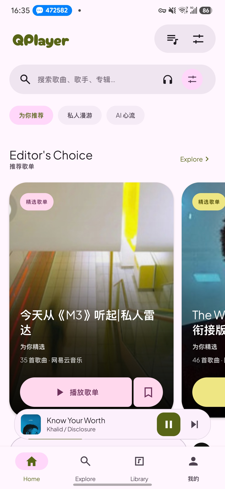
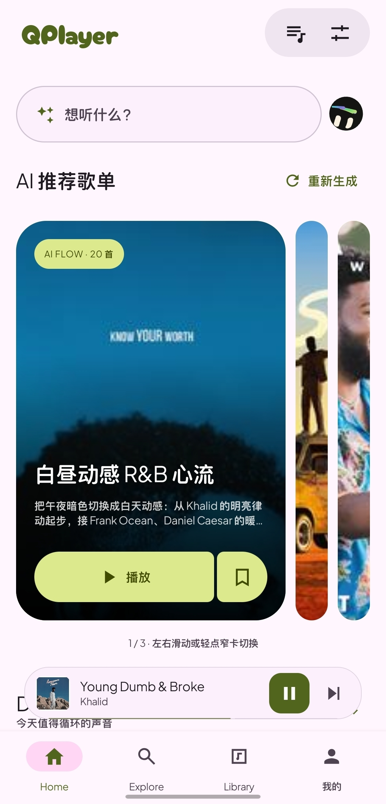
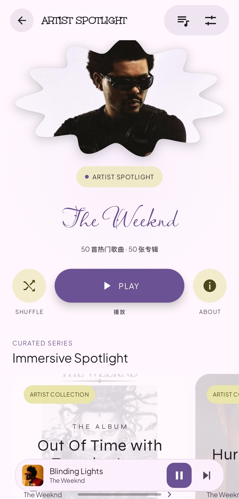

<h1 align="center">QPlayer Next</h1>
<p align="center">Music, motion, and your next discovery.</p>
<p align="center"><a href="README.md">简体中文</a> · <b>English</b></p>

QPlayer Next is the Android Compose / MD3E branch of QPlayer. It brings NetEase Cloud Music, local audio, Bilibili media, and AI curation into one player, with Material 3 Expressive, classic Material, Claude, and iOS visual modes.

The current UI is built with native Jetpack Compose. Playback, lyrics, service integrations, and account handling reuse the Java core. The app interface is primarily Simplified Chinese; music metadata retains its original language.

## Screenshots

<table>
  <tr>
    <td align="center"><br>MD3E home</td>
    <td align="center"><br>AI playlists</td>
    <td align="center"><br>Artists</td>
    <td align="center"><br>MV playback</td>
  </tr>
</table>

See the [Chinese README](README.md#界面预览) for all 12 screenshots, including other themes and AI conversations. Screenshots include different modes and development stages; the current source may have newer visual details.

## Features

- Four visual modes, light/dark themes, cover-based colors, decorative typography, shared-element transitions, and MiniPlayer animations.
- NetEase QR login, discovery, search, playlists, albums, artists, local audio scanning, and caching.
- AI music conversations with sentence-by-sentence replies, playable playlist cards, generated follow-up suggestions, and locally persisted conversation history.
- Three daily AI playlists with 20–30 tracks each, guided by listening and collection samples; manual regeneration, editing, reordering, and saving to a NetEase account.
- Experimental continuous AI DJ with next-batch preparation, recommendation reasons, and mascot transitions.
- Word/line lyrics, translations, animated scrolling, and optional looping MV backgrounds that follow playback state.
- Local AutoMix rendering, automatic cue points, transition duration and pitch controls, next-track caching, and preparation status.
- Bilibili search, QR login, favorites, multi-part videos, and audio/video playback.
- Swipe-to-queue with haptics, drag reordering, sleep timer, background playback, and system media controls.
- Listening statistics, charts, and a record wall backed by NetEase listening data. Availability and freshness depend on the service and account.

AI features require your own compatible API endpoint, model, and key. Regular playback does not require AI configuration.

## Languages and technology

| Area | Technology |
| --- | --- |
| UI | Kotlin 2.0.21, Jetpack Compose, Material 3 |
| Core | Java, Gson, qml4j property bridge |
| Android services | MediaSession, foreground playback service, Android media APIs |
| Background work | Kotlin Coroutines |
| Visual effects | Material Color Utilities, Backdrop, Graphics Shapes |
| Embedded animation | HTML / JavaScript in Android WebView |
| Build | Gradle 8.7, Android Gradle Plugin 8.6.1, JDK 17 |

## Build

Requires **JDK 17**, **Android SDK Platform 35**, and **Build Tools 35.0.0**. Minimum runtime: Android 8.0 / API 26. Open `android-md3e` in Android Studio, and set `ANDROID_HOME` or your own `sdk.dir` in `android-md3e/local.properties`.

```powershell
# Windows
.\gradlew.bat -p android-md3e :app:assembleDebug
```

```sh
# macOS / Linux
chmod +x gradlew
./gradlew -p android-md3e :app:assembleDebug
```

Output: `android-md3e/app/build/outputs/apk/debug/app-debug.apk`.
Application ID: `dev.t1m3.qplayer.md3e`.
The first build needs network access to resolve dependencies. Use `--offline` only with a complete cache.

Core test example:

```sh
./gradlew -p android-md3e :core:test --tests 'dev.t1m3.qplayer.ai.AiConversationHistoryTest' --tests 'dev.t1m3.qplayer.ai.AiMusicConversationTest'
```

For a signed Release build, set `QPLAYER_KEYSTORE`, `QPLAYER_STORE_PASSWORD`, `QPLAYER_KEY_ALIAS`, and optionally `QPLAYER_KEY_PASSWORD`, then run `:app:assembleRelease`. Signing keys and passwords are not distributed. Without signing configuration, Release output is unsigned.

## Repository layout

- `android-md3e/app`: Compose application, resources, fonts, and animations.
- `android-md3e/core`: Gradle module compiling `player-core` directly.
- `android-md3e/platform`: Android integration module.
- `android-shell/app/src/main/java`: shared platform and iOS/glass components required by the current application.
- `player-core/src`: Java core and unit tests.
- `docs/screenshots`: device screenshots used in the documentation.

## Support and contributions

Please [open an issue](https://github.com/xiaozhuhou233/qplayer-next/issues) with your app/Android versions, visual mode, and reproduction steps. For playback issues, include the provider and track. Remove cookies and API keys before sharing logs. Pull requests for UI, performance, compatibility, and service fixes are welcome.

## Attribution and licenses

Based on [QPlayer](https://github.com/TIMER-err/qplayer). Its original license is preserved in [LICENSE.md](LICENSE.md). Bundled third-party components retain their respective licenses; see [THIRD_PARTY.md](THIRD_PARTY.md) and the notices distributed with the source.
