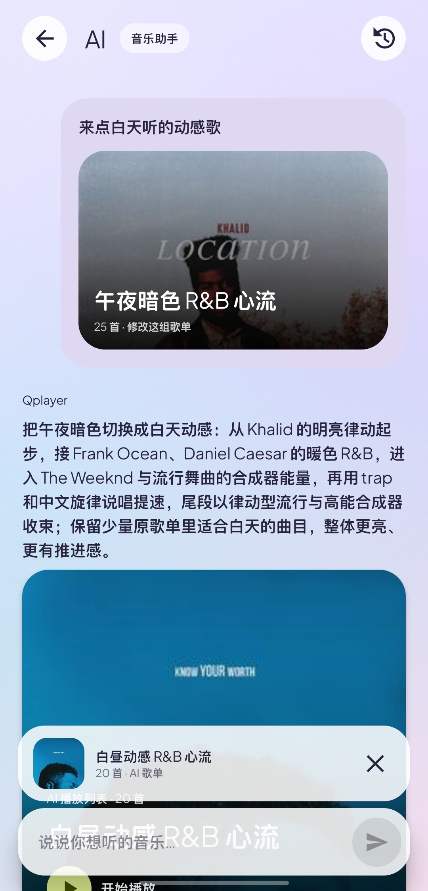
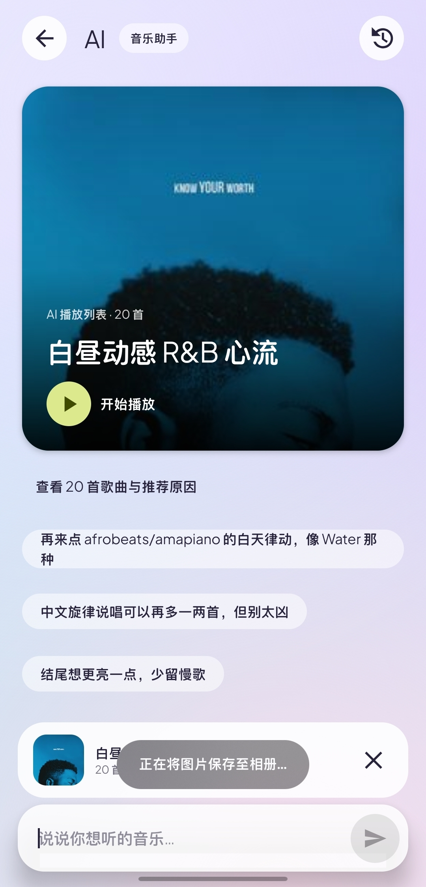
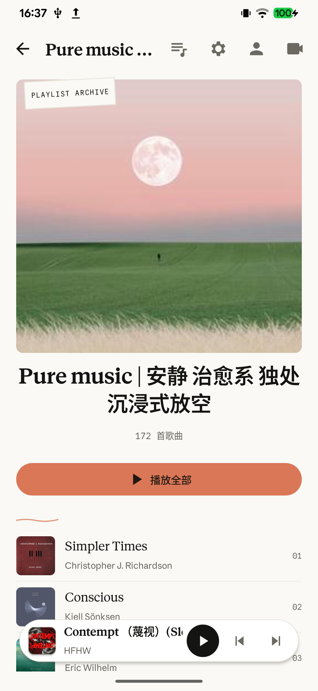
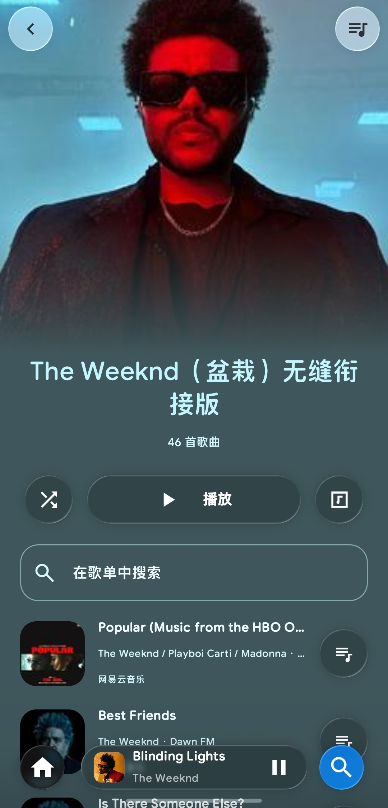
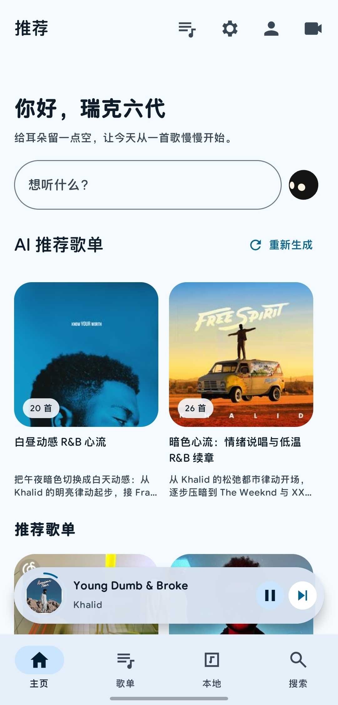
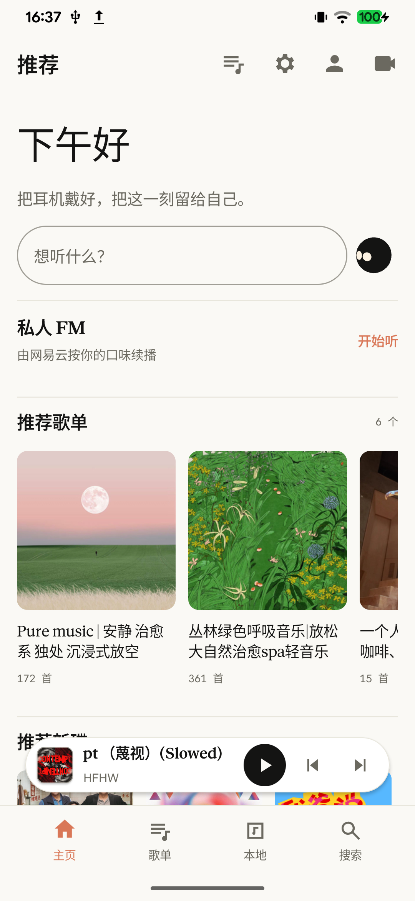
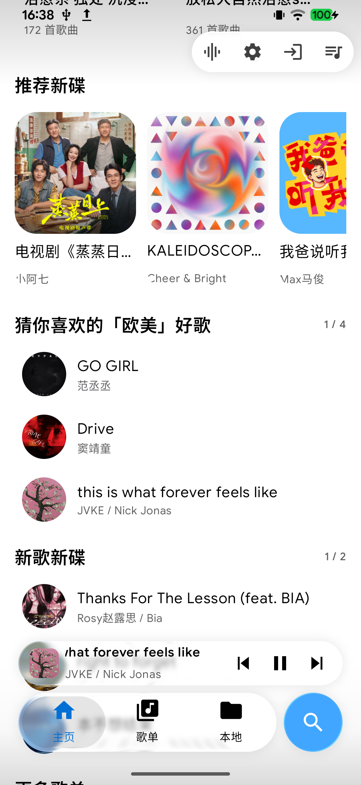

<h1 align="center">QPlayer Next</h1>

<p align="center">音乐、画面，以及为你选的下一首。</p>
<p align="center"><b>简体中文</b> · <a href="README.en.md">English</a></p>
<p align="center">
  
  
  
  
</p>

QPlayer Next 是 QPlayer 的 Android Compose / MD3E 源码分支。它把网易云音乐、本地音乐、B 站音视频与 AI 选曲放进同一个播放器，提供 Material 3 Expressive、经典 Material、Claude 和 iOS 四种视觉模式。

新版界面使用原生 Jetpack Compose；播放、歌词解析、音源与账号逻辑复用 Java 核心。这个仓库提供当前 MD3E 应用的源码和构建所需组件。

## 界面预览

<table>
  <tr>
    <td align="center"><br>MD3E 首页</td>
    <td align="center"><br>AI 推荐歌单</td>
    <td align="center"><br>歌手与专辑</td>
    <td align="center"><br>MV 播放详情</td>
  </tr>
</table>

<table>
  <tr>
    <td align="center"><br>对话修改歌单</td>
    <td align="center"><br>可播放的 AI 回答</td>
    <td align="center"><br>歌单详情</td>
    <td align="center"><br>液态玻璃控件</td>
  </tr>
</table>

<details>
<summary>更多主题截图</summary>
<table>
  <tr>
    <td align="center"><br>Material</td>
    <td align="center"><br>Claude</td>
    <td align="center"><br>iOS</td>
    <td align="center"><br>彩色 MiniPlayer</td>
  </tr>
</table>
</details>

截图由实机拍摄，包含不同模式和开发阶段；界面细节以当前源码为准。

## 特色功能

- **四种视觉模式**：MD3E 的大封面与动态取色、经典 Material、Claude 风格和 iOS 液态玻璃；支持深浅主题、艺术字开关、共享元素转场和 MiniPlayer 展开动画。
- **网易云与本地音乐**：扫码登录、推荐、搜索、歌单、专辑、歌手、本地扫描和音频缓存；支持将 AI 歌单保存到网易云账号。
- **AI 音乐对话**：用文字描述场景、口味和修改需求；回答逐句呈现，直接生成可播放的歌单卡片。对话可保存到本地，从右侧历史列表恢复继续，后续建议随 AI 回答生成。
- **每日 AI 歌单**：结合听歌历史和收藏样本，围绕相近曲风、不同作者或情绪生成三组歌单，每组 20–30 首；支持手动重新生成、增删歌曲和排序。
- **实验性 AI DJ**：长按吉祥物进入独立的连续推荐模式；分批推荐，提前准备下一组，用吉祥物与推荐原因衔接播放。
- **歌词与 MV**：逐字 / 整行歌词、翻译与滚动动画；有 MV 时可使用循环视频背景，跟随播放状态暂停和继续。
- **自动混音**：本地融合、自动点位、过渡时长和降调开关，提前缓存下一首；融合进度与点位信息可在播放页查看。
- **B 站音视频**：搜索、扫码登录、收藏夹、分 P 与音视频播放。
- **队列与系统播放**：左滑添加队列并提供触感反馈、拖动排序、睡眠定时器、后台播放、锁屏 / 通知栏媒体控制。
- **听歌足迹**：网易云听歌数据、周期统计、图表与唱片墙。云端数据的可用性和更新速度受网易云接口及账号权限影响。

AI 功能需要自行配置兼容的 API 地址、模型与 Key；播放器功能不要求配置 AI。

## 语言与技术支持

应用界面以简体中文为主，歌曲、专辑与歌手名称保留来源语言。项目主要使用以下语言与技术：

| 层次 | 语言 / 技术 | 用途 |
| --- | --- | --- |
| Android 界面 | Kotlin 2.0.21、Jetpack Compose、Material 3 | 页面、动画、主题与交互 |
| 播放与业务核心 | Java、Gson、qml4j 属性桥接 | 播放队列、网易云 / B 站接口、歌词、AI、缓存 |
| Android 集成 | MediaSession、前台服务、Android 媒体 API | 音频焦点、通知、后台播放、本地文件 |
| 异步任务 | Kotlin Coroutines | 网络、图片、AI 生成与历史存储 |
| 视觉效果 | Material Color Utilities、Backdrop、Graphics Shapes | 动态配色、玻璃材质与不规则轮廓 |
| 内嵌动画 | HTML / JavaScript、Android WebView | 吉祥物与私人漫游动画 |
| 构建 | Gradle 8.7、AGP 8.6.1、JDK 17 | Android 构建与 Java 单元测试 |

## 源码结构

```text
android-md3e/
  app/                 Compose 界面、字体、动画与资源
  core/                直接编译 player-core 源码的 Gradle 模块
  platform/            Android 平台模块
android-shell/
  app/src/main/java/   构建使用的共享平台代码与 iOS / 玻璃组件
player-core/
  src/main/            Java 播放与业务核心
  src/test/            核心单元测试
docs/screenshots/      本 README 的实机截图
gradle/wrapper/        Gradle Wrapper
```

`android-shell` 在本仓库中只保留新版构建引用的组件；Android 入口是 `android-md3e`。

## 构建

需要 **JDK 17**、**Android SDK Platform 35**、**Build Tools 35.0.0**。最低运行版本为 Android 8.0（API 26）。Android Studio 打开 `android-md3e` 目录即可导入。

设置 `ANDROID_HOME`，或在 `android-md3e/local.properties` 中配置自己的 `sdk.dir`。首次构建需要联网下载依赖。

**Windows PowerShell**

```powershell
.\gradlew.bat -p android-md3e :app:assembleDebug
```

**macOS / Linux**

```sh
chmod +x gradlew
./gradlew -p android-md3e :app:assembleDebug
```

调试安装包位于 `android-md3e/app/build/outputs/apk/debug/app-debug.apk`。应用 ID 为 `dev.t1m3.qplayer.md3e`。若依赖已缓存，可增加 `--offline`；使用自定义 Maven 本地仓库时，可传入 `-Dmaven.repo.local=<路径>`。

核心测试示例：

```sh
./gradlew -p android-md3e :core:test --tests 'dev.t1m3.qplayer.ai.AiConversationHistoryTest' --tests 'dev.t1m3.qplayer.ai.AiMusicConversationTest'
```

**Release 签名**通过环境变量配置：`QPLAYER_KEYSTORE`、`QPLAYER_STORE_PASSWORD`、`QPLAYER_KEY_ALIAS`，以及可选的 `QPLAYER_KEY_PASSWORD`，然后运行 `:app:assembleRelease`。仓库不提供私钥和签名密码；未配置签名时生成未签名 Release 包。

## 反馈与贡献

遇到问题请提交 [Issue](https://github.com/xiaozhuhou233/qplayer-next/issues)，附上应用版本、Android 版本、视觉模式和复现步骤；涉及播放时补充音源与歌曲。提供日志前请移除账号 Cookie、API Key 等个人信息。

欢迎提交界面、性能、兼容性与接口修复的 Pull Request。

## 来源与许可

项目基于 [QPlayer](https://github.com/TIMER-err/qplayer) 发展，原项目许可证保留于 [LICENSE.md](LICENSE.md)。第三方组件、字体与参考实现保留各自许可，详见 [THIRD_PARTY.md](THIRD_PARTY.md) 和源码内的 notices；原项目许可证不替代这些第三方许可。
